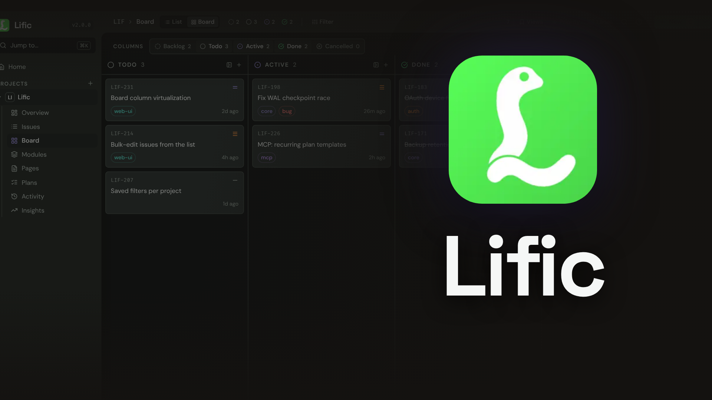

# BacklogBridge-MCP

<p align="center">
  
</p>

<p align="center">
  <a href="https://github.com/Gopisokk/BacklogBridge-MCP/actions"></a>
  <a href="https://github.com/Gopisokk/BacklogBridge-MCP/releases"></a>
  <a href="LICENSE"></a>
  <a href="https://modelcontextprotocol.io"></a>
</p>

<p align="center">
  <strong>An issue tracker and project backlog bridge designed for prolific AI agents and developers.</strong><br>
  One single binary. One SQLite file. MCP built in.
</p>

---

## 💡 Overview

**BacklogBridge-MCP** bridges your development backlogs, tasks, and system planning directly into agentic workflows via the **Model Context Protocol (MCP)**. 

Plans and issues live on your server instead of consuming precious context windows, ensuring that task context, architecture plans, and milestone progress outlive individual sessions. Agents interact seamlessly over MCP tools; developers inspect and organize everything via an intuitive, blazing-fast web UI.

- **31 MCP Tools in ~5.7k tokens**: Lean and lightning fast for agent tool calling.
- **Single Self-Contained Binary**: SQLite, embedded Svelte web UI, and backup pipelines bundled in a compact ~25–32 MB binary (zero external database dependencies).
- **Universal AI Client Integration**: Automated setup (`connect`) for Claude Code, Cursor, OpenCode, VS Code, Zed, Gemini, Windsurf, and more.
- **Clean Identifiers**: Human-readable task references like `APP-42` instead of messy UUIDs.
- **Created & Maintained by**: [Gopi Rk](https://github.com/Gopisokk)

---

## ⚡ Quick Start

### 1. Install & Initialize

```bash
# Clone the repository
git clone https://github.com/Gopisokk/BacklogBridge-MCP.git
cd BacklogBridge-MCP

# Run initialization (sets up config, SQLite database, admin account)
cargo run -- init

# Connect your AI agents & MCP clients
cargo run -- connect
```

Access the Web Dashboard at: **`http://localhost:3456`**

### 2. Connect Your AI Clients

BacklogBridge-MCP supports direct configuration for:
- Claude Code / Claude Desktop
- Cursor
- OpenCode
- VS Code / Windsurf
- Zed
- Gemini CLI / Goose / Codex

```bash
# Automatically discover and configure installed clients
cargo run -- connect

# Headless / targeted configuration
cargo run -- connect --client cursor --yes
cargo run -- connect --client claude-code --scope project
```

---

## 🛠️ MCP Tool Capabilities

BacklogBridge-MCP exposes dedicated tool sets designed specifically for LLMs and autonomous agents:

| Tool Category | Tools | Capabilities |
| :--- | :--- | :--- |
| **Issues** | `list_issues`, `get_issue`, `create_issue`, `update_issue`, `bulk_update`, `edit_issue`, `get_board` | Complete task management, progress verification, and status updates |
| **Relations & Dependencies** | `link_issues`, `unlink_issues` | Task blocking, person waits, and relational workflows |
| **Pages & Docs** | `get_page`, `create_page`, `update_page`, `edit_page` | Contextual architectural and project documentation |
| **Step Plans** | `create_plan`, `get_plan`, `edit_plan_step`, `update_plan_step` | Granular multi-step plans that sync with issues and survive context resets |
| **Comments & Proof** | `add_comment`, `list_comments`, `edit_comment`, `delete_comment` | Evidence tracking and verification logs |
| **Search & Briefing** | `get_briefing`, `search`, `get_activity` | Catch up on changes (`since`), fetch workable tasks, search backlogs |
| **Resources** | `list_resources`, `manage_resource`, `delete`, `export` | Project organization and workspace structure |

---

## 💻 CLI Usage

You can manage BacklogBridge-MCP straight from your terminal:

```bash
# List workable issues for a project
backlogbridge-mcp issue list --project APP

# Create a new issue
backlogbridge-mcp issue create --project APP --title "Implement OAuth handshake" --priority high

# Mark work complete
backlogbridge-mcp issue update APP-42 --status done

# Search your backlog
backlogbridge-mcp search "authentication flow" --project APP
```

---

## ⚙️ Configuration & Self-Hosting

### Standalone Server
```bash
# Start server manually
cargo run -- start --port 3456
```

### Docker Setup
```bash
docker build -t backlogbridge-mcp .
docker run -d -p 3456:3456 -v backlog-data:/data \
  -e LIFIC_INIT_ADMIN_NAME="Gopi Rk" \
  -e LIFIC_INIT_ADMIN_PASSWORD="your-secure-password" \
  backlogbridge-mcp
```

### Automated Backups
Automated hourly SQLite backups with archive rotation:
```bash
cargo run -- dump                                    # Safe snapshot while running
cargo run -- restore backlog_backup_2026.tar.gz      # Restore snapshot
```

---

## 🏗️ Architecture & Development

Built with high performance and minimal memory footprint in mind:
- **Core Engine**: Rust 2024 edition (Axum, Tokio, SQLite / rusqlite)
- **Web Frontend**: Svelte 5, Tailwind CSS v4, Lucide icons, Vite
- **Protocols**: Model Context Protocol (stdio & Streamable HTTP), WebSockets, SSE

To build from source:
```bash
git clone https://github.com/Gopisokk/BacklogBridge-MCP.git
cd BacklogBridge-MCP

# Build release binary
cargo build --release
```

---

## 👤 Author & Maintainer

- **Creator / Maintainer**: **Gopi Rk** ([@Gopisokk](https://github.com/Gopisokk))
- **Email**: `gopi030506@gmail.com`
- **Repository**: [https://github.com/Gopisokk/BacklogBridge-MCP](https://github.com/Gopisokk/BacklogBridge-MCP)

---

## 📄 License

Licensed under the [Apache-2.0 License](LICENSE).
